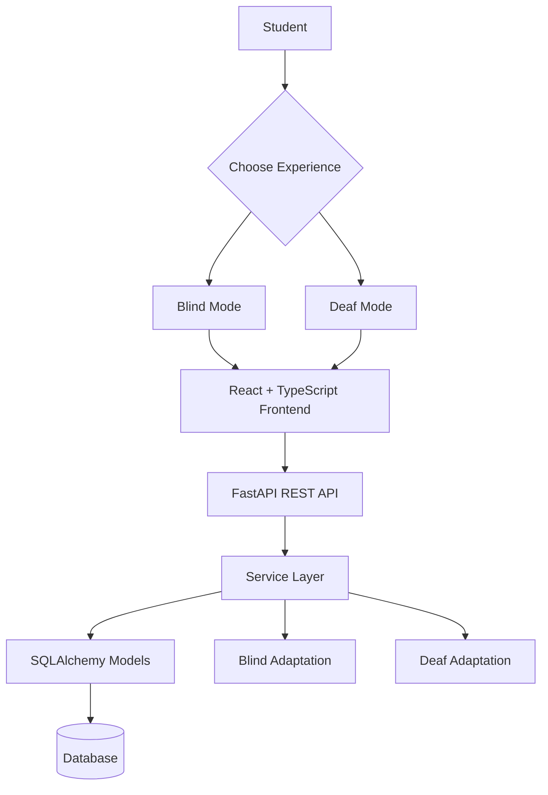

 <div align="center">

# Shikshit Bharat

[](https://git.io/typing-svg)

*A unified digital learning platform built for inclusive education in Indian classrooms.*

<br/>


<br/>

**One learning platform. Two dedicated accessibility experiences.**

</div>

---

## 💡 The Problem

Traditional digital classrooms often deliver content in a single format, leaving students with different accessibility needs struggling to participate independently.

- **Blind learners** may miss visual information on classroom boards, slides, diagrams, and learning materials.
- **Deaf learners** may miss spoken explanations and classroom announcements when accessible sign-language content and visual alternatives are unavailable.
- **Educators** need a consistent way to organize lessons and announcements without maintaining entirely separate learning systems.

Accessibility should be part of the learning experience from the beginning, not an afterthought.

## 🚀 The Solution: Shikshit Bharat

Shikshit Bharat is an inclusive digital education platform designed around two dedicated learning experiences: Blind Mode and Deaf Mode.

Rather than treating accessibility as a simple interface toggle, the platform provides distinct content representations and interaction patterns tailored to each learner.

<details>
<summary><b>What makes the approach different?</b></summary>

- Separate API responses for Blind and Deaf learners.
- Shared lesson and classroom-announcement foundations.
- Audio-oriented content and Braille-ready text for Blind learners.
- ISL-oriented grammatical glosses and visual content for Deaf learners.
- A React-based frontend connected to a FastAPI backend.
- An architecture designed to support future accessibility modules.

</details>

---

## 👁️ Blind Mode — Audio-First Learning

Designed to make learning content accessible through speech, keyboard navigation, and Braille-compatible representations.

### ⭐ Key Features

- **Audio-First Content:** Structured narration transcripts and descriptive notes for visual material, including formulas and diagrams.
- **Prioritized Announcements:** Audio urgency metadata supports prioritizing critical classroom notifications.
- **Braille-Ready Content:** ASCII Braille and six-dot Unicode Braille representations support future Braille input and display integrations.
- **Dedicated API Responses:** Lesson and announcement endpoints return content tailored to Blind learners.
- **Accessible Interaction:** The frontend is designed around keyboard navigation and speech-based interaction.

### API Endpoints

| Endpoint | Purpose |
|---|---|
| `GET /api/v1/lessons/{id}/blind` | Retrieve an adapted lesson |
| `GET /api/v1/announcements/blind` | Retrieve prioritized announcements |

---

## 🤟 Deaf Mode — Visual-First Learning

Designed to represent classroom content visually, with a focus on Indian Sign Language (ISL) grammatical structure and accessible text.

### ⭐ Key Features

- **ISL-Oriented Content:** Subject-Object-Verb (SOV) grammatical glossing supports ISL-oriented lesson representations.
- **Sign Token Sequences:** Token identifiers and media pointers support client-side sign representation.
- **Visual Notifications:** Dedicated announcement responses support visual alerts and classroom updates.
- **Accessible Transcripts:** Captioned and simplified textual content supports comprehension.
- **Dedicated API Responses:** Lesson and announcement endpoints return content tailored to Deaf learners.

### API Endpoints

| Endpoint | Purpose |
|---|---|
| `GET /api/v1/lessons/{id}/deaf` | Retrieve an adapted lesson |
| `GET /api/v1/announcements/deaf` | Retrieve visual-first announcements |

---

## 🏗️ System Architecture

Shikshit Bharat separates its user interface, API, business logic, and data models to support maintainability and future expansion.



### Core Components

| Layer | Responsibility |
|---|---|
| **Frontend** — `frontend/` | React, TypeScript, Tailwind CSS, and React Router |
| **API** — `app/api/` | Versioned REST endpoints under `/api/v1` |
| **Services** — `app/services/` | Business logic and content adaptation |
| **Models** — `app/models/` | Lessons, announcements, progress, and sensory adaptations |
| **Schemas** — `app/schemas/` | Pydantic request validation and response structures |
| **Core** — `app/core/` | Configuration, database sessions, and application setup |

---

## 🧰 Technology Stack

<div align="center">


</div>

- **Frontend:** React, TypeScript, Vite, Tailwind CSS, React Router.
- **Backend:** Python, FastAPI, Uvicorn.
- **Database Layer:** SQLAlchemy, PostgreSQL, SQLite for lightweight local development.
- **Validation:** Pydantic schemas.
- **Accessibility:** Web Speech API integration, Braille-ready representations, keyboard-oriented navigation, and ISL-oriented content structures.

---

## ⚡ Getting Started

### Prerequisites

- Python 3.10+
- Node.js 18+
- npm
- Git
- PostgreSQL, or SQLite for local development

### 1. Clone the Repository

```bash
git clone https://github.com/navyaanubhutii/Shikshit_Bharat.git
cd Shikshit_Bharat
```

### 2. Set Up the Backend

Create and activate a virtual environment.

**Windows**

```powershell
python -m venv venv
.\venv\Scripts\Activate.ps1
```

**Linux / macOS**

```bash
python -m venv venv
source venv/bin/activate
```

Install the dependencies:

```bash
pip install -r requirements.txt
```

### 3. Configure the Backend

Copy the example environment file:

```powershell
Copy-Item .env.example .env
```

On Linux or macOS:

```bash
cp .env.example .env
```

Configure `DATABASE_URL` in `.env` to match your local database setup. For lightweight development, use SQLite if supported by your configuration:

```env
DATABASE_URL=sqlite:///./shikshit_bharat.db
```

Do not commit credentials or secrets to GitHub.

### 4. Start the Backend

From the repository root:

```bash
uvicorn app.main:app --host 127.0.0.1 --port 8000 --reload
```

Once the server starts, open:

- **Swagger UI:** http://localhost:8000/docs
- **ReDoc:** http://localhost:8000/redoc

### 5. Set Up the Frontend

Open a second terminal:

```bash
cd frontend
```

Create the local environment file from the example:

```powershell
Copy-Item .env.example .env
```

On Linux or macOS:

```bash
cp .env.example .env
```

Install dependencies and start Vite:

```bash
npm install
npm run dev
```

Open the local URL printed by Vite, typically:

http://localhost:5173

Ensure `VITE_API_BASE_URL` points to the running backend API, typically:

```env
VITE_API_BASE_URL=http://localhost:8000/api/v1
```

---

## 🖥️ Frontend Experiences

| Route | Experience | Description |
|---|---|---|
| `/` | Mode Selector | Choose the appropriate accessibility experience |
| `/blind` | Blind Mode | Audio-first learning experience |
| `/deaf` | Deaf Mode | Visual-first learning experience |

### Frontend Structure

```text
frontend/
├── public/
├── src/
│   ├── components/
│   ├── pages/
│   │   ├── LandingPage.tsx
│   │   ├── BlindEntryPage.tsx
│   │   └── DeafEntryPage.tsx
│   ├── services/
│   ├── types/
│   ├── utils/
│   ├── App.tsx
│   ├── main.tsx
│   └── index.css
├── .env.example
├── package.json
└── vite.config.ts
```

---

## 📡 API Overview

All application endpoints are versioned under `/api/v1`.

### Health

| Method | Endpoint | Purpose |
|---|---|---|
| `GET` | `/api/v1/health` | Check API health |
| `GET` | `/api/v1/health/db` | Check database connectivity |

### Lessons

| Method | Endpoint | Purpose |
|---|---|---|
| `GET` | `/api/v1/lessons` | List lessons |
| `POST` | `/api/v1/lessons` | Create a lesson |
| `GET` | `/api/v1/lessons/{id}` | Retrieve a lesson and its adaptations |
| `GET` | `/api/v1/lessons/{id}/blind` | Retrieve Blind-adapted content |
| `GET` | `/api/v1/lessons/{id}/deaf` | Retrieve Deaf-adapted content |

### Classroom Announcements

| Method | Endpoint | Purpose |
|---|---|---|
| `GET` | `/api/v1/announcements` | List announcements |
| `POST` | `/api/v1/announcements` | Create an announcement |
| `GET` | `/api/v1/announcements/blind` | Retrieve audio-prioritized announcements |
| `GET` | `/api/v1/announcements/deaf` | Retrieve visual-first announcements |

---

## 🔮 Future Roadmap

The architecture is intended to support further development in inclusive learning:

- **Priority Audio Queue:** Scheduling and collision handling for simultaneous spoken notifications.
- **Virtual Perkins Brailler:** Interactive six-dot Braille input through standard keyboards.
- **Expanded ISL Support:** Richer sign-language media and interaction workflows.
- **Offline Learning:** Cached lessons and synchronization for limited-connectivity environments.
- **Accessible Assessments:** Inclusive quizzes, student progress tracking, and educator analytics.

These are future directions, not claims that every feature is already implemented.

---

<div align="center">

### 🌱 Education Without Barriers

*Building more accessible digital learning experiences for India.*

**Shikshit Bharat** · Inclusive Education · Accessibility by Design

</div>
